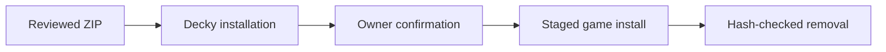

# CreamDeck Hardened

A SmokeAPI-only Decky plugin for owner-approved offline Proton games, managed independently per game, intended for a Legion Go 2 running SteamOS.

This fork keeps the GPL-3.0 license and credits Qiming-Liu's [upstream CreamDeck](https://github.com/Qiming-Liu/CreamDeck), based on commit `242a6147`.
CreamInstaller by FroggMaster supplied the upstream install approach. SmokeAPI is by acidicoala. The library-menu patch derives from CheatDeck and decky-steamgriddb.

## Scope and remaining verification

| Kept | Removed and reason |
|---|---|
| Bundled SmokeAPI, direct or proxy mode | CreamAPI, ScreamAPI, Uplay R1, Uplay R2 and Koaloader to reduce code and binary scope |
| HTTPS DLC metadata | SteamCMD download, extraction and execution to remove executable downloads |
| Decky user permissions | Root flag and privileged development script to contain filesystem access |
| Per-app settings journals | Game-local proxy state and config-based detection to prevent unsafe cleanup |

SmokeAPI has been installed and removed once in Sleeping Dogs. Gameplay and DLC unlocking have not been verified.
The DLL pins match the upstream CreamDeck snapshot and the official SmokeAPI v4.1.3 release; see `resources/SmokeAPI/PROVENANCE.md`.
The opaque DLLs' network behavior, configuration compatibility and credential access are unverified.

## Owner allowlist

The allowlist starts empty. The owner must confirm that the current game is offline single-player with no anti-cheat, then choose **Add this game to owner allowlist**.
Never add an online game, including one that offers an offline mode. A marker scan cannot establish that a game is safe.
The backend independently requires this allowlist and rejects EAC/BattlEye markers down to 16 folders deep, ignoring case. It refuses if deeper folders prevent a complete scan.
Several games can have active installs. Each game has its own journal and launch options. Remove or recover that game's previous installation before reinstalling it. Active installs cannot share files or overlapping game folders.
New installs still require valid journals and no interrupted settings write so file conflicts can be checked. Status and recovery use only the selected game's journal.

## Install the reviewed ZIP

1. Complete review and Linux verification before putting this fork on the device. Retain an independent copy of the selected game's clean DLLs, saves and exact launch options.
2. Verify `out/CreamDeckHardened.zip` against `out/SHA256SUMS` on the build machine. The checksum file also covers every ZIP member after extraction.
3. Enable Decky's developer options and use **Install from ZIP** to select the archive. If the installed Decky build offers a URL installer only, use its documented local ZIP installation method instead.
4. Confirm the installed entry is **CreamDeck Hardened**. Its package folder is `CreamDeckHardened`, distinct from upstream `CreamDeck`.
5. Close the selected game. Open its library menu, select **CreamDeck Hardened**, confirm the owner rule, and add it to the allowlist.
6. Select the available DLC and install SmokeAPI. Zero DLC is valid; the plugin never downloads DLC content. Only enable content whose files are already present.

## Modes and launch options

| Mode | Behavior |
|---|---|
| Direct | Original Steam API DLLs in the top folder or one unambiguous nested API folder are renamed to `_o.dll` backups before installing replacements |
| Proxy | A free `version.dll`, `winmm.dll` or `winhttp.dll` is created in the top folder while originals remain intact |

Proxy mode requires an unambiguous API architecture. A game with both 32-bit and 64-bit top-level APIs must use direct mode.
Direct mode preserves existing proxy DLLs and warns on removal if their recorded hashes changed. It never changes launch options or requires their restoration.
Launch options are read through SteamClient with a five-second timeout. The exact original and proposed replacement are journaled before any write.
Automatic changes support only empty options, exactly `%command%`, or an unquoted simple path followed by ` %command%`.
Other syntax is refused unless the owner selects manual launch-option management. In that case the plugin installs files, records the exact original and leaves Steam options untouched.
Set the override and restore the original manually in Steam Properties. The plugin never merges an existing `WINEDLLOVERRIDES` assignment.
If an automatic change cannot be confirmed, check Steam Properties. The game files may already be installed; **Remove / recover SmokeAPI** stays available.

## Removal and recovery

Use **Remove / recover SmokeAPI** with the game closed. The backend restores originals only when recorded installed and backup hashes match.
After an update it preserves changed DLLs and reports: `game changed since install, run Verify integrity in Steam`.
Only matching recorded config, proxy and staging files are removed. Unknown files are preserved. Mismatches retain the journal and block further installs.
Original launch options are restored only while the current string exactly matches the plugin's proposed string. Later owner changes remain untouched.
Removing the Decky plugin itself does not undo game changes. Remove the game installation first and retain settings until rollback is complete.

## Manual rollback

1. Close the game and disable CreamDeck Hardened in Decky. Keep the per-app record and independent backups for inspection.
2. Read `<appid>.json` from the distinct settings directory supplied by `decky.DECKY_PLUGIN_SETTINGS_DIR`. Confirm its `game_dir` against the actual library location yourself.
3. In Steam Properties restore the exact `original_launch_options`, unless you deliberately changed it afterward. Resolve any later edits manually.
4. Compare the record's hashes with `sha256sum` of the named files. Remove only recorded created config/proxy/staging files that still match. Preserve unknown or modified files for inspection.
5. For direct mode, restore a recorded backup only if the current DLL matches the recorded installed hash and the backup matches the original hash. After a game update, preserve the newer DLL and run Steam **Verify integrity** instead of restoring an older backup.
6. Inspect the remaining `_o.dll` backups. Archive matching old backups outside the game only after Steam has supplied a clean current DLL. Resolve any unknown file manually.
7. Check that the game directory contains no plugin-created leftovers. Archive the resolved settings record outside the `.json` record namespace before a fresh install. Never reset a malformed record merely to unblock installation.
8. Re-enable Decky only after rollback is complete. A full Steam UI restart clears a menu patch left by older upstream versions.

## Development and package verification

| Command | Purpose |
|---|---|
| `python -m unittest discover -s tests -v` | Backend regressions without network or Decky runtime |
| `node --test tests/frontend.test.cjs` | Launch-option and menu-patch regressions |
| `pnpm exec tsc --noEmit` | Frontend typecheck |
| `pnpm build` | Build `dist/index.js` |
| `python scripts/package_release.py` | Build ZIP, verify members and write `out/SHA256SUMS` |

Production filesystem operations require Linux `O_NOFOLLOW`, directory descriptors, directory fsync and `renameat2` with no replacement.
They fail closed on unsupported hosts. Windows unit runs use an explicit test-only filesystem adapter; Linux runs use the production implementation.
Confirm the device Python version, Decky's user-home/settings helpers and real SteamOS behavior before device testing.
